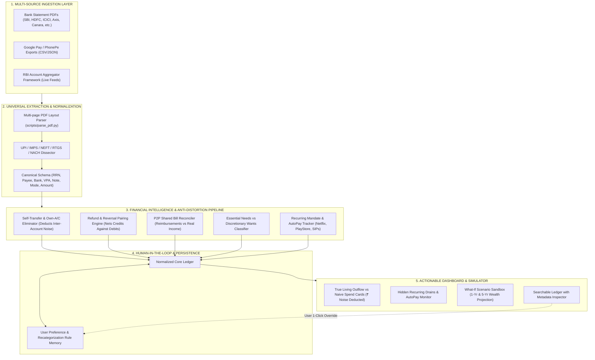

# Happy Pocket / FinLens (F-05): Financial Visibility and Hidden Expense Discovery

> **Theme:** CONSUMER FINANCE  
> **Domain:** SPENDING ANALYSIS  
> **Problem Statement Code:** F-05  

---

## 📌 Problem Background & Official Statement

### Context
Individuals often struggle to understand where their money goes, particularly when spending is distributed across multiple accounts, payment methods, recurring subscriptions, loan repayments, and everyday purchases. Individually small expenses can accumulate into significant financial commitments, while irregular spending and poorly understood payment patterns can make budgeting difficult.

### Official Problem Statement
> **Develop a solution that transforms fragmented financial activity into a clear, useful picture of an individual's spending behaviour, recurring commitments, and overall financial position.**
>
> The solution should help users categorise transactions, identify recurring payments, distinguish essential commitments from discretionary spending, and recognise meaningful changes in their financial behaviour. It should account for transfers between a user's own accounts, refunds, irregular income, shared expenses, and other transactions that may distort a simple spending summary.
>
> Users should be able to investigate unexpected spending, estimate the future impact of recurring commitments, compare actual expenditure against a budget, and explore practical adjustments to improve their financial position. The solution should make its conclusions understandable and allow users to correct inaccurate classifications or assumptions.

### Expected Outcome
> A financial visibility tool that consolidates transaction information into an understandable spending picture, identifies recurring or overlooked expenses, highlights emerging financial pressures, and helps users evaluate actionable ways to manage their money.

---

## 🏛️ End-to-End System Architecture



---

## 🔄 How Happy Pocket Solves F-05 (Feature Walkthrough)

### 1. Eliminating Distortion & False Inflation
* **Self-Transfer Deduping:** Transfers between a user's own accounts (e.g., transfers referencing the user's name or linked accounts like SBI $\leftrightarrow$ Canara) are recognized and tagged as `INTERNAL_TRANSFER`. Their spending impact is set to **₹0.00** so expenses aren't doubled.
* **Refund Pairing:** Returns (e.g. Meesho, Zara, Amazon return credits) are offset directly against original purchases rather than being falsely counted as "Income".
* **P2P Shared Bill Offsets:** Peer reimbursements (e.g., friends sending their share for dinner via UPI) are credited back against the dining category.

### 2. Deep UPI & Multi-Channel Transaction Dissection
Cluttered bank narrations like:
```text
WDL TFR UPI/DR/203821706198/MEESHO T/UTIB/MEESHOONLI/UPI 0097695162091 AT 40184 DONIMALAI TOWNSHIP
```
are dissected into clean, actionable data points:
- **Transaction Mode:** `WDL TFR` (Withdrawal Transfer)
- **NPCI RRN:** `203821706198` (12-digit universal reference)
- **Payee / Merchant:** `MEESHO`
- **Acquiring Bank:** `UTIB` (Axis Bank)
- **VPA Handle:** `@MEESHOONLI`
- **CBS Terminal Reference & Branch:** `0097695162091 AT 40184` · `DONIMALAI TOWNSHIP`

### 3. Recurring Commitment & "Zombie Drain" Discovery
- Detects recurring cadence ($T \approx 30\text{ days}$) alongside `Mand` and `Execu` UPI AutoPay flags.
- Tracks commitments like **Netflix India**, **Google Play Store AutoPay**, **GoDaddy Domains**, and utility mandates.
- Calculates monthly burn and annual financial drain in Indian Rupees (`₹`).

### 4. Human-in-the-Loop & "What-If" Simulation Sandbox
- **Explainable Decisions:** Every categorization includes transparent reasoning and an instant **Recategorize** button that saves custom rules for future statements.
- **Interactive Sandbox:** Users can toggle cancellation of forgotten trials or test reducing discretionary dining/delivery by 10%–50% to see immediate 1-year and 5-year compounding wealth impact.

---

## 📂 Repository Structure

```
.
├── .gitignore                              # Clean ignore rules (Node, Next, Python, OS)
├── README.md                               # Comprehensive Project Documentation
├── package.json                            # Root NPM dependencies & scripts
├── tsconfig.json                           # TypeScript configuration
├── next.config.ts                          # Next.js App Router configuration
├── eslint.config.mjs                       # Linter configuration
│
├── docs/                                   # In-Depth Technical Specifications
│   ├── APP_WORKFLOW_ARCHITECTURE.md        # Full application workflow & data lifecycle
│   ├── FINANCIAL_VISIBILITY_SOLUTION.md    # Initial F-05 problem deconstruction
│   ├── INDIAN_TRANSACTION_DATA_SPEC.md     # Technical spec on NPCI UPI, RRNs & IFSC formats
│   └── REAL_DATA_INGESTION_GUIDE.md        # RBI Account Aggregator & GPay Takeout export guide
│
├── scripts/
│   └── parse_pdf.py                        # Universal multi-format Indian banking parser CLI
│
└── src/
    ├── app/
    │   ├── api/parse-pdf/route.ts          # Multipart file upload API endpoint
    │   ├── globals.css                 # Clean modern styling
    │   ├── layout.tsx                  # Root HTML layout
    │   └── page.tsx                    # Interactive Financial Visibility Dashboard
    ├── data/
    │   └── mockData.ts                 # Seed bank simulation data & edge cases
    ├── lib/
    │   ├── engine.ts                   # Financial visibility & anti-distortion algorithms
    │   └── pdfParser.ts                # Client-side parser utilities
    └── types/
        └── finance.ts                  # Canonical TypeScript schemas
```

---

## 🛠️ Quick Start & Local Setup

### Prerequisites
- **Node.js**: v18+ (v22 recommended)
- **Python**: 3.9+ with `pypdf` installed:
  ```bash
  python3 -m pip install pypdf
  ```

### 1. Install Dependencies & Launch Dev Server
```bash
npm install
npm run dev
```
Open **[http://localhost:3000](http://localhost:3000)** in your browser.

### 2. Parse a Bank Statement
- Drag & drop any Indian bank statement PDF (e.g. SBI, HDFC, ICICI) directly onto the upload zone.
- Or click **"Load Sample Bank Statement"** to run the complete pipeline instantly.

### 3. Run Parser from Command Line (CLI)
You can also run the Python extractor directly on any PDF statement:
```bash
python3 scripts/parse_pdf.py /path/to/statement.pdf
```

---

## 📚 Technical Documentation & Specs

For deeper technical deep-dives, see the `docs/` folder:
- **[Complete Features Catalog & Specification](docs/FEATURES_CATALOG.md)**: Full inventory of all live ingestion, anti-distortion, and visibility features.
- **[Ingestion Layer Gap Analysis & Roadmap](docs/INGESTION_LAYER_ROADMAP.md)**: Deep dive into statement parsing, password unlocking, and future AA integrations.
- **[Security, Privacy & Compliance Guide](docs/SECURITY_AND_PRIVACY_GUIDE.md)**: Zero-knowledge parsing, DPDP Act 2023, PII masking, and data protection.
- **[Full App Workflow & Architecture](docs/APP_WORKFLOW_ARCHITECTURE.md)**: End-to-end data pipeline, mermaid diagrams, and user journey.
- **[F-05 Solution Architecture](docs/FINANCIAL_VISIBILITY_SOLUTION.md)**: Problem deconstruction, algorithms, and system design.
- **[Indian Transaction Data Specification](docs/INDIAN_TRANSACTION_DATA_SPEC.md)**: Complete breakdown of NPCI UPI strings, RRNs, IFSC bank codes, and regex parsing.
- **[Real Data Ingestion Guide](docs/REAL_DATA_INGESTION_GUIDE.md)**: Open Banking, RBI Account Aggregators (Setu/OneMoney), and GPay Takeout exports.
