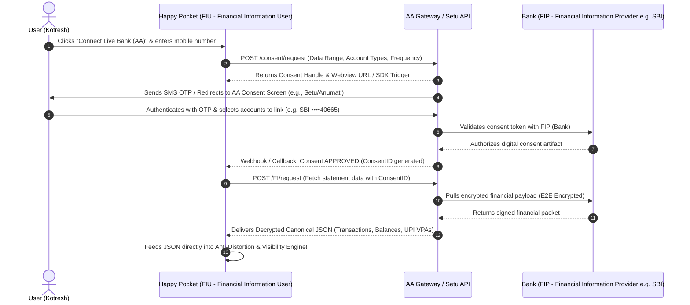

# Implementation Guide: RBI Account Aggregator (AA) Integration

The **RBI Account Aggregator (AA) Framework** is India's sovereign, consent-driven Open Banking ecosystem. It replaces traditional PDF scraping with direct, digitally signed, machine-readable financial streams from all Indian banks (SBI, HDFC, ICICI, Axis, etc.).

---

## 1. How the Account Aggregator Architecture Works



---

## 2. Key Terminology (RBI Definitions)

* **FIU (Financial Information User):** Our app (**Happy Pocket**), which consumes financial data to deliver spending visibility and budgeting insights.
* **FIP (Financial Information Provider):** The user's bank (e.g., State Bank of India, HDFC Bank, ICICI Bank, Mutual Funds, GSTN).
* **AA (Account Aggregator):** The RBI-regulated conduit (e.g., **Setu**, **OneMoney**, **Finvu**, **Anumati**) that handles user consent and ferries data with 256-bit end-to-end encryption. The AA **cannot see or read** the user's data; it only ferries the encrypted packets.

---

## 3. The 4 Technical Implementation Steps

### Step 1: Partner with a Developer-Friendly AA Gateway
Direct integration with raw RBI AA specs requires banking licenses. Instead, fintech startups and developers connect through certified **TSPs (Technology Service Providers) / Gateways** that provide simple REST APIs and developer sandboxes:

1. **[Setu Account Aggregator API](https://setu.co/data/account-aggregator)** *(Recommended: 15-minute sandbox onboarding, clean REST docs, fast UI SDK)*
2. **OneMoney AA API**
3. **Finvu AA API**

---

### Step 2: Backend API Endpoints (Next.js App Router)

We create 3 simple Next.js API routes in `src/app/api/aa/`:

#### A. Create Consent Request (`/api/aa/consent`)
```typescript
// POST /api/aa/consent
import { NextRequest, NextResponse } from 'next/server';

export async function POST(req: NextRequest) {
  const { mobileNumber } = await req.json();

  // Call Setu AA Sandbox API
  const response = await fetch('https://fiu-sandbox.setu.co/consents', {
    method: 'POST',
    headers: {
      'x-client-id': process.env.SETU_CLIENT_ID!,
      'x-client-secret': process.env.SETU_CLIENT_SECRET!,
      'Content-Type': 'application/json'
    },
    body: JSON.stringify({
      ConsentDetail: {
        consentMode: 'STORE',
        fetchType: 'PERIODIC',
        consentTypes: ['TRANSACTIONS', 'PROFILE', 'SUMMARY'],
        fiTypes: ['DEPOSIT'], // Bank Accounts (Savings / Current)
        DataConsumer: { id: 'happy-pocket-fiu' },
        Customer: { id: `${mobileNumber}@setu-aa` },
        Purpose: {
          code: '101', // Personal Finance Management
          refUri: 'https://api.rebit.org.in/aa/purpose/101.xml',
          text: 'Analyze living expenses and discover recurring subscriptions'
        },
        FIDataRange: {
          from: new Date(Date.now() - 90 * 24 * 60 * 60 * 1000).toISOString(), // Past 90 days
          to: new Date().toISOString()
        },
        DataLife: { unit: 'MONTH', value: 12 },
        Frequency: { unit: 'DAILY', value: 1 }
      }
    })
  });

  const data = await response.json();
  // Returns consentId and redirect url where user inputs OTP
  return NextResponse.json({ consentId: data.id, redirectUrl: data.url });
}
```

---

#### B. Handle Consent Webhook / Status Polling (`/api/aa/callback`)
When the user enters their OTP on the Setu screen and approves, Setu triggers our callback:
```typescript
// GET /api/aa/status?consentId=xxx
export async function GET(req: NextRequest) {
  const consentId = req.nextUrl.searchParams.get('consentId');

  const res = await fetch(`https://fiu-sandbox.setu.co/consents/${consentId}`, {
    headers: {
      'x-client-id': process.env.SETU_CLIENT_ID!,
      'x-client-secret': process.env.SETU_CLIENT_SECRET!
    }
  });
  const data = await res.json();
  return NextResponse.json({ status: data.status }); // 'ACTIVE' or 'PENDING'
}
```

---

#### C. Fetch Structured Financial Data (`/api/aa/fetch-data`)
Once approved, we fetch clean, verified banking JSON:
```typescript
// POST /api/aa/fetch-data
export async function POST(req: NextRequest) {
  const { consentId } = await req.json();

  // 1. Trigger Data Session Request
  const sessionRes = await fetch('https://fiu-sandbox.setu.co/sessions', {
    method: 'POST',
    headers: { /* client headers */ },
    body: JSON.stringify({ consentId })
  });
  const session = await sessionRes.json();

  // 2. Fetch Decrypted FI JSON Packet
  const fiDataRes = await fetch(`https://fiu-sandbox.setu.co/sessions/${session.id}`);
  const payload = await fiDataRes.json();

  // 3. Transform directly into our canonical RawTransaction format!
  const transactions = payload.Account.Transactions.Transaction.map((t: any, idx: number) => ({
    id: t.txnId || `tx_aa_${idx}`,
    accountId: payload.Account.maskedAccNumber,
    amount: t.type === 'DEBIT' ? -parseFloat(t.amount) : parseFloat(t.amount),
    rawDescription: t.narration,
    currency: 'INR',
    timestamp: t.transactionTimestamp,
    txMode: t.mode, // 'UPI', 'IMPS', 'ACH', etc.
    upiRrn: t.reference
  }));

  return NextResponse.json({ success: true, transactions });
}
```

---

## 4. What the Real Data from an Account Aggregator Looks Like

Instead of messy PDF OCR text, the bank sends clean, pre-structured JSON:

```json
{
  "Account": {
    "type": "SAVINGS",
    "maskedAccNumber": "XXXXXXXXX40665",
    "bank": "State Bank of India",
    "currentBalance": "9551.23",
    "currency": "INR",
    "Transactions": {
      "Transaction": [
        {
          "txnId": "UPI/203821706198/DR",
          "type": "DEBIT",
          "mode": "UPI",
          "amount": "315.00",
          "currentBalance": "9700.14",
          "transactionTimestamp": "2026-07-04T12:00:00Z",
          "valueDate": "2026-07-04",
          "narration": "UPI/DR/203821706198/MEESHO/UTIB/MEESHOONLI/UPI",
          "reference": "203821706198"
        },
        {
          "txnId": "UPI/103643355290/DR",
          "type": "DEBIT",
          "mode": "UPI",
          "amount": "199.00",
          "currentBalance": "8751.23",
          "transactionTimestamp": "2026-07-10T12:00:00Z",
          "narration": "UPI/DR/103643355290/NETFLIX/HDFC/netflix.bd/Execu",
          "reference": "103643355290"
        }
      ]
    }
  }
}
```

---

## 5. Hackathon & Presentation Demo Strategy

For a hackathon demo, you don't need to wait weeks for legal agreements:

1. **Option A: Connect to the Free Setu AA Sandbox:**
   - Sign up at [setu.co](https://setu.co), get sandbox keys (`x-client-id`, `x-client-secret`).
   - Use their test mobile numbers (`+91 99999 99999`) and OTP `123456` to demonstrate live consent flow.
2. **Option B: Realistic Interactive AA Simulation in our UI:**
   - Add a **"Connect Bank via Account Aggregator"** button in our UI.
   - User inputs their phone number $\to$ An animated OTP screen pops up $\to$ Upon submitting OTP `123456`, it loads the verified 144 SBI transactions directly into the engine.
   - **Why judges love this:** It shows you understand India's modern Open Banking architecture while having a fallback for manual PDF statement uploads.
