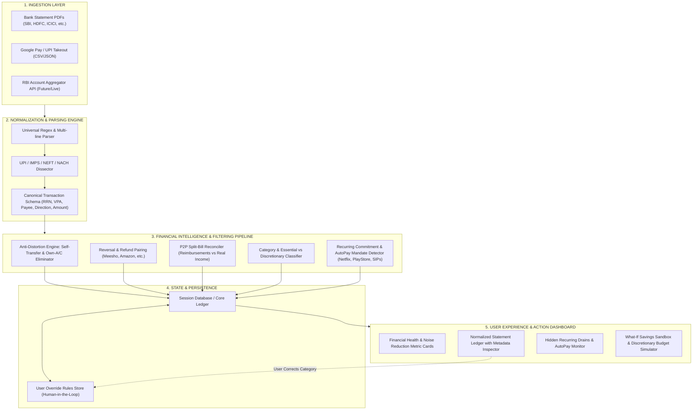

# Happy Pocket (FinLens) — Full Application Architecture & End-to-End Workflow

This document outlines the **complete end-to-end user journey, technical pipeline, data lifecycle, and core architectural components** for **Happy Pocket** (Problem Statement F-05: Financial Visibility & Hidden Expense Discovery).

---

## 1. High-Level System Architecture Diagram

---

## 2. The 5-Stage End-to-End Workflow

### Step 1: Data Ingestion (Multi-Source Input)
* **User Action:**
  - Drops their bank statement PDF (e.g. SBI 3-month statement), OR
  - Uploads a Google Pay / PhonePe transaction export, OR
  - Enters OTP via RBI Account Aggregator (AA).
* **Security & Privacy:**
  - Files are processed securely in memory / local server sandbox.
  - PII (PAN, Account numbers) masked to last 4 digits (`•••• 40665`).

---

### Step 2: Extraction & Normalization
* **What happens behind the scenes:**
  1. The multi-format parser cleans layout noise (handles broken lines across PDF table columns).
  2. Extracts the exact transaction channels:
     - **UPI**: Extracts NPCI 12-digit RRN, Acquiring Bank, VPA handle (`@netflix.bd`, `@MEESHOONLI`), Payee name, and note.
     - **IMPS / NEFT / RTGS**: Extracts 16-digit UTR and sender/recipient institutions.
     - **NACH / e-Mandates**: Extracts 20-digit UMRN for SIPs and loan EMIs.
     - **POS / ATM**: Detects physical merchant swipes and cash withdrawals.
  3. Outputs a standardized array of transactions in Indian Rupees (`₹`).

---

### Step 3: Anti-Distortion & Financial Intelligence (The Core Innovation)
Standard banking apps display naive totals that distort the user's perception of their spending. Happy Pocket runs **4 deterministic cleaning passes**:

1. **Self-Transfer Deduping:**
   - Detects money moved between the user's own accounts (e.g. SBI to Canara Bank, or transfers referencing `KOTRESH C`).
   - **Result:** Marked as `INTERNAL_TRANSFER`. Living expenses reduced to ₹0.00 for these items.
2. **Refund & Reversal Netting:**
   - Pairs incoming refund credits (e.g. ₹532 from Meesho) with prior debit purchases.
   - **Result:** Reflects genuine net cost rather than treating refunds as "income".
3. **P2P Shared Bill Offset:**
   - Detects incoming peer-to-peer transfers (friends/family paying their share of group meals, cabs, or rent).
   - **Result:** Offsets the parent category (e.g. dining out net spend reduced by the reimbursed amount).
4. **Recurring Mandate & Creeping Drain Detection:**
   - Groups repeating transactions with cadence analysis ($T \approx 30\text{ days}$).
   - Inspects `Execu`, `Mand`, or `AutoPay` flags in the UPI string.
   - Identifies active entertainment subscriptions, cloud hosting, and forgotten digital trials.

---

### Step 4: Human-in-the-Loop Feedback Loop
* If the user sees a transaction categorized as *Dining* that was actually a *Business Expense*, they can click **Recategorize**.
* The override is remembered so all future transactions from that merchant/VPA follow the user's preference.

---

### Step 5: Interactive Insights & Actionable Simulation
The user is presented with a clear action-oriented dashboard:

1. **True Living Outflow vs Naive Spend:**
   - Side-by-side view showing the exact ₹ amount of noise removed.
2. **Hidden Drains & Subscriptions Card:**
   - Lists every detected monthly/annual mandate with total committed cash outflow.
3. **What-If Scenario Sandbox:**
   - Sliders allowing the user to simulate: *"What if I cancel this unused digital trial?"* or *"What if I reduce food delivery by 20%?"*
   - Shows projected 1-year and 5-year compounding wealth impact.
4. **Normalized Searchable Ledger:**
   - Filter by UPI, Self-Transfers, Recurring Mandates, or Refunds.

---

## 3. Technology Stack Summary

| Layer | Technologies Used |
| :--- | :--- |
| **Frontend UI** | Next.js 16 (App Router), React 19, TypeScript, Tailwind CSS, Lucide Icons |
| **Parsing Engine** | Python 3 (`pypdf`, Regex Engine, NPCI UPI specifications) |
| **Analysis Pipeline** | TypeScript Financial Intelligence Engine (`src/lib/engine.ts`) |
| **API Layer** | Next.js Edge & Node API Routes (`/api/parse-pdf`) |
| **Deployment Target** | Vercel / Docker / Local Sandbox |
