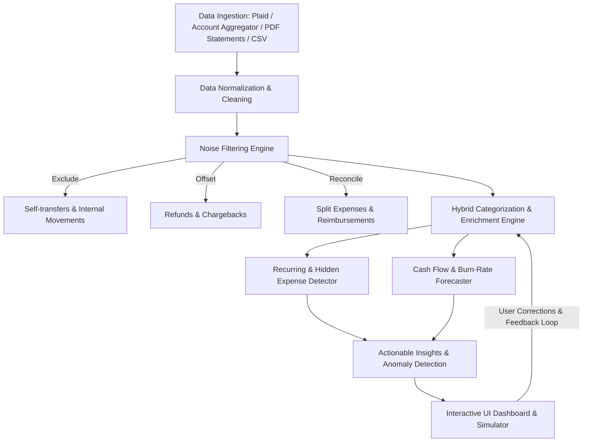

# Solution Architecture & Implementation Plan: Financial Visibility and Hidden Expense Discovery (F-05)

## 1. Problem Deconstruction & Objectives

### Core Challenges Identified
1. **Multi-source Data Fragmentation:** Spending scattered across bank accounts, credit cards, digital wallets, UPI, BNPL (Buy-Now-Pay-Later), and cash.
2. **Noise & Distortions:**
   - Self-transfers (inter-account transfers) inflating spend metrics.
   - Reversals, chargebacks, and refunds improperly netted.
   - Shared bills / split expenses (e.g., Splitwise, one person pays and others reimburse).
   - Irregular / freelance income distorting cash flow projections.
3. **Hidden / Creeping Costs:**
   - Micro-subscriptions and "free trial" rollovers.
   - Silent price hikes / inflation creep on regular bills.
   - Inactive or "zombie" recurring services.
4. **Interpretability & Human-in-the-Loop:** Users need clear reasoning for why an item was classified, with seamless manual overrides that tune the model.

---

## 2. High-Level System Architecture



---

## 3. Detailed Component Architecture

### A. Data Ingestion & Normalization
* **Connectors:** 
  - Open Banking / Account Aggregators (RBI AA framework in India, Plaid/Teller in US/UK/EU).
  - Manual upload fallback: Bank statement parser (PDF / CSV) using OCR and tabular extraction (e.g., `pdfplumber`, regex heuristics).
  - SMS transaction scrapers (for mobile apps with user consent).
* **Canonical Data Schema:**
  ```json
  {
    "transaction_id": "tx_987123",
    "account_id": "acc_chase_checking",
    "timestamp": "2026-10-24T14:32:00Z",
    "amount": -14.99,
    "currency": "USD",
    "raw_description": "APPLE.COM/BILL 866-712-7753 CA",
    "clean_merchant": "Apple Services",
    "direction": "DEBIT",
    "category": "Entertainment / Subscriptions",
    "is_recurring": true,
    "is_internal_transfer": false,
    "net_amount": -14.99,
    "confidence_score": 0.94
  }
  ```

---

### B. Anti-Distortion & Noise-Filtering Engine

To prevent artificial inflation of income or spending:

1. **Self-Transfer Elimination:**
   - **Rule-based & Heuristic Windowing:** Identify pairs where Account A has `-X` and Account B has `+X` within a time window $\Delta t \le 48\text{ hrs}$.
   - **Transaction Metadata:** Detect keywords like `OWN A/C TRF`, `TFR`, `NEFT to self`, `CC Payment`, etc.
   - Tagged as `INTERNAL_TRANSFER` and removed from net outflow calculations.
2. **Refund & Reversal Pairing:**
   - Match negative and positive transactions with matching merchant entities or exact counterparties within a 30-day window.
   - Update `net_amount` rather than reporting positive cash flow as "Income".
3. **Shared Expenses / Reimbursements:**
   - Identify inflow transactions referencing previous outflows (e.g., UPI note "Dinner split", Venmo memo matching recent restaurant spend).
   - Net against the category spend (e.g., $100 restaurant spend with $50 reimbursement = $50 real dining spend).

---

### C. Hybrid Categorization & Enrichment Engine

* **Layer 1: Deterministic Merchant Normalization & Regex Rules:**
  - High-precision matching against known merchant lookup tables (e.g., Netflix, Spotify, Amazon, Uber, Utility providers).
* **Layer 2: Zero-Shot / Few-Shot LLM Categorizer (Small Fine-Tuned Model or Embedded Classifier):**
  - Uses description + MCC (Merchant Category Code) + spend context to categorize into a two-tiered taxonomy:
    - **Tier 1:** Essential (Fixed Needs) vs. Discretionary (Wants).
    - **Tier 2:** Granular categories (Housing, Utilities, Groceries, Dining, Software, Mobility, Debt Service).
* **Layer 3: Active Learning / User Feedback Loop:**
  - User rule overrides (e.g., *"Mark all transactions from merchant X as Business Expense"*).
  - Saved as custom rule overrides stored with precedence over ML predictions.

---

### D. Recurring Commitment & "Hidden Drain" Detection Engine

1. **Detection Heuristics & Algorithms:**
   - **Periodicity Detection:** Fast Fourier Transform (FFT) or Autocorrelation / interval variance analysis on merchant transaction clusters ($\Delta t \approx 7, 14, 30, 365\text{ days} \pm 3\text{ days}$).
   - **Price Variance Analysis:**
     - *Exact match:* Fixed subscriptions ($14.99/mo).
     - *Variable regular bills:* Utilities, phone plans with variable usage.
   - **Zombie / Inactive Subscription Detection:**
     - Track services where monthly charges continue, but secondary indicators show zero engagement (or simply alerting: *"You've paid \$45 over 3 months for Service X"*).
   - **Silent Price Increase Alerts:**
     - Flags when a regular recurring payment increases (e.g., \$9.99 $\to$ \$12.99).

---

### E. Budgeting, Anomaly Detection & Practical Adjustments

* **Dynamic Baseline Calculation:**
  - Calculates rolling 3-month medians for discretionary categories to flag lifestyle creep and unexpected surges.
* **Committed vs. Safe-to-Spend Balance:**
  $$\text{Safe-to-Spend} = \text{Liquid Balance} - \sum \text{Upcoming Recurring Bills before next income} - \text{Emergency Buffer}$$
* **"What-If" Scenario Simulator:**
  - *"What if I cancel these 3 unused subscriptions?"* $\to$ Computes compounding 1-year and 5-year savings.
  - *"What if I cut dining out by 20%?"* $\to$ Visualizes timeline to debt payoff or savings target.

---

## 4. Suggested Technology Stack

| Layer | Recommended Stack | Rationale |
| :--- | :--- | :--- |
| **Frontend** | React / Next.js / TypeScript + Tailwind CSS / Shadcn UI + Recharts | Responsive, clean visualizations, financial cards, interactive Sankey & line charts |
| **Backend API** | Python (FastAPI) or Node.js (NestJS / Express) | Python excels for financial math, pandas data manipulation, and ML modules |
| **Data Processing & ML**| `pandas`, `scikit-learn` (clustering), `RapidFuzz` (fuzzy merchant match) | High speed for tabular parsing and fuzzy entity deduplication |
| **LLM Reasoning** | Gemini 1.5 Flash / Claude 3.5 Haiku (via function calling) | Ultra-fast, cost-effective for contextual merchant explanation and categorizing ambiguous memo lines |
| **Database** | PostgreSQL (with TimescaleDB or `pgvector` for merchant search) | ACID compliance for financial records, time-series indexing |
| **Security & Privacy** | AES-256 at rest, TLS 1.3 in transit, client-side data anonymization | Sensitive financial data compliance (PII masking) |

---

## 5. UI/UX Feature Breakdown (The "Financial Visibility" Product)

1. **Cash Flow Sankey Diagram:** Visual flow from Net Income $\to$ Non-discretionary (Bills/Debt) $\to$ Discretionary $\to$ Net Savings.
2. **"Subscription Graveyard" Card:** Highlights forgotten trials, creeping costs, and one-click cancellation guides.
3. **Dispute & Correct Modal:** Every insight has an *"Is this wrong?"* trigger that explains the decision tree and allows 1-click re-categorization.
4. **Impact Projection Calculator:** Sliders allowing users to see immediate monthly and annual impact of trimming flagged expenses.

---

## 6. Implementation Roadmap (Hackathon / MVP Plan)

```
Phase 1: Ingestion & Filtering (Hours 0-8)
├── CSV/Statement upload parser
├── Self-transfer deduplication algorithm
└── Refund offset logic

Phase 2: Categorization & Recurring Detection (Hours 8-16)
├── Fuzzy merchant lookup table
├── Periodicity detector (30d / weekly cycles)
└── Essential vs Discretionary classifier

Phase 3: Insights & UI Dashboard (Hours 16-24)
├── Spend breakdown & Sankey view
├── Creeping expense / price hike alert feed
└── User manual override system
```
