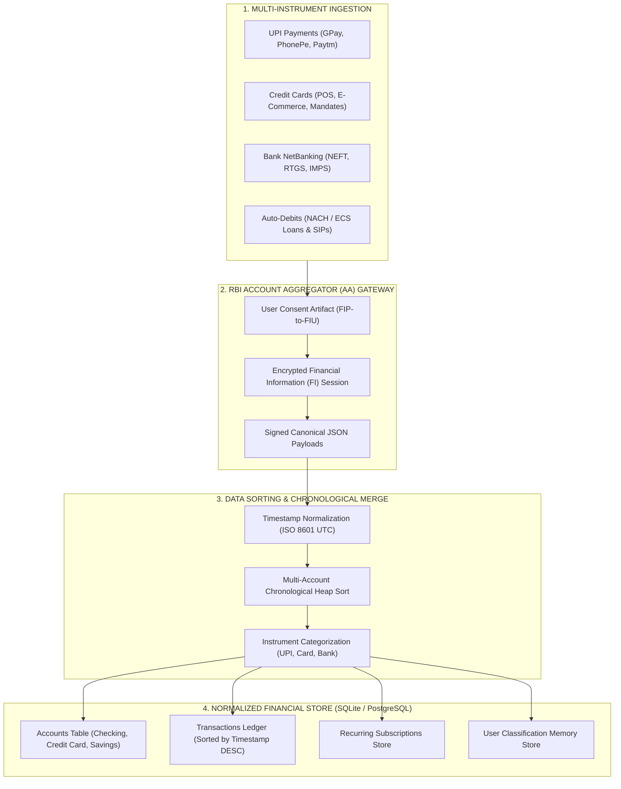

# RBI Account Aggregator (AA): Simulation, Ingestion & Multi-Account Storage Specification

This document details:
1. **Interactive Simulation:** How we simulate multi-account financial feeds (UPI, Credit Cards, NetBanking, NACH) for demo & testing.
2. **Data Acquisition:** How data is retrieved across different payment instruments under the RBI AA framework.
3. **Data Sorting & Database Architecture:** How multi-account raw records are normalized, deduplicated, sorted, and stored for fast analytical queries.

---

## 1. Multi-Account Simulation & Data Ingestion Flow



---

## 2. Ingestion by Payment Instrument (How Data Enters)

Under the RBI Account Aggregator framework, different financial instruments are categorized under specific **FITypes** (Financial Information Types):

### A. UPI (FIType: `DEPOSIT` / Savings Accounts)
* **Where it comes from:** The underlying bank account linked to the user's UPI app (e.g. SBI, HDFC).
* **Payload Fields Received:**
  - `txnId`: Unique bank transaction reference.
  - `reference`: 12-digit NPCI RRN (`203821706198`).
  - `narration`: Full UPI string (`UPI/DR/203821706198/MEESHO/UTIB/MEESHOONLI/UPI`).
  - `type`: `DEBIT` or `CREDIT`.
  - `amount`: Number in INR (`315.00`).
  - `currentBalance`: Balance post-transaction.

### B. Credit Cards (FIType: `CREDIT_CARD`)
* **Where it comes from:** Card issuers (SBI Card, HDFC Credit, Amex, Axis Bank).
* **Payload Fields Received:**
  - `maskedCardNumber`: `XXXXXXXXXXXX1008`.
  - `transactionType`: `POS` (physical swipe), `ECOM` (online purchase), or `AUTOPAY`.
  - `merchantName`: `AMAZON PAY INDIA`, `ZARA RETAIL BANGALORE`.
  - `billingCycleDate`: Statement cut-off date.
  - `creditLimit` & `availableCredit`.

### C. Bank NetBanking & Instant Transfers (FIType: `DEPOSIT`)
* **Where it comes from:** Core banking systems for NEFT, RTGS, IMPS, and ATM cash.
* **Payload Fields Received:**
  - `mode`: `IMPS`, `NEFT`, `RTGS`, `ATM-WDL`.
  - `utr`: 16-digit Unique Transaction Reference.
  - `remitterIfsc` & `beneficiaryIfsc`.

### D. Auto-Debits / Recurring (FIType: `RECURRING_MANDATE` / NACH)
* **Where it comes from:** NPCI NACH clearinghouse.
* **Payload Fields Received:**
  - `umrn`: 20-digit Unique Mandate Reference Number.
  - `corporateName`: `HDFC MUTUAL FUND`, `TATA AIA LIFE INSURANCE`.
  - `frequency`: `MONTHLY`, `QUARTERLY`.

---

## 3. Data Sorting, Merging & Deduplication Engine

When ingesting multiple accounts (e.g. 1 SBI Savings + 1 Canara Bank + 1 HDFC Credit Card), the engine executes **3 sorting and cleaning stages**:

### Stage 1: Timestamp Normalization & Multi-Source Merge
Different institutions output dates in varying formats (`DD-MM-YYYY HH:mm:ss`, `YYYY-MM-DDTHH:mm:ssZ`, or `DD/MM/YYYY`).
* All timestamps are normalized to **UTC ISO 8601** (`2026-10-24T18:30:00Z`).
* The streams are merged into a unified timeline using a **Chronological Merge Sort** ($O(N \log N)$).

### Stage 2: Cross-Account Self-Transfer Pairing (Noise Sorting)
To avoid false inflation:
1. Scan for debits on Account A and credits on Account B where:
   $$\text{Amount}_A = -\text{Amount}_B \quad \text{and} \quad |\Delta t| \le 72\text{ hours}$$
2. Re-sort these transactions into an `INTERNAL_MOVEMENTS` partition with net living spend = ₹0.00.

### Stage 3: Multi-Index Sorting for Instant Querying
Transactions are sorted into multi-level index structures:
- **Primary Order:** Timestamp `DESC` (most recent first).
- **Secondary Index:** Merchant / Entity cluster (groups repeating charges for subscription detection).
- **Tertiary Index:** Category & Tier (`Essential` vs. `Discretionary`).

---

## 4. Database Schema for Multi-Account Storage (SQL / PostgreSQL)

```sql
-- 1. Accounts Table (Consolidated View)
CREATE TABLE accounts (
    id VARCHAR(64) PRIMARY KEY,
    user_id VARCHAR(64) NOT NULL,
    institution_name VARCHAR(128) NOT NULL, -- 'State Bank of India', 'HDFC Bank'
    account_type VARCHAR(32) NOT NULL,      -- 'SAVINGS', 'CURRENT', 'CREDIT_CARD'
    masked_acc_number VARCHAR(32) NOT NULL, -- '•••• 40665'
    currency VARCHAR(8) DEFAULT 'INR',
    current_balance DECIMAL(15, 2) NOT NULL,
    fip_id VARCHAR(64),                     -- FIP ID in Account Aggregator network
    last_synced_at TIMESTAMP WITH TIME ZONE
);

-- 2. Transactions Table (Consolidated Ledger)
CREATE TABLE transactions (
    id VARCHAR(64) PRIMARY KEY,
    account_id VARCHAR(64) REFERENCES accounts(id),
    timestamp TIMESTAMP WITH TIME ZONE NOT NULL,
    value_date DATE,
    amount DECIMAL(15, 2) NOT NULL,         -- Negative for debit, positive for credit
    balance_after DECIMAL(15, 2),
    raw_narration TEXT NOT NULL,
    
    -- Dissected Multi-Channel Metadata
    channel VARCHAR(32) NOT NULL,           -- 'UPI', 'CARD', 'IMPS', 'NEFT', 'NACH'
    reference_id VARCHAR(64),               -- 12-digit RRN or 16-digit UTR
    beneficiary_name VARCHAR(128),          -- Clean merchant / payee
    acquiring_bank VARCHAR(16),             -- 'UTIB', 'HDFC', 'SBIN'
    vpa_handle VARCHAR(128),                -- 'MEESHOONLI', 'netflix.bd'
    user_note TEXT,
    
    -- Financial Visibility Flags
    category VARCHAR(64) NOT NULL,          -- 'Groceries', 'Subscriptions', etc.
    tier VARCHAR(32) NOT NULL,              -- 'Essential', 'Discretionary', 'Transfer_or_Offset'
    is_internal_transfer BOOLEAN DEFAULT FALSE,
    paired_transfer_id VARCHAR(64),
    is_refund BOOLEAN DEFAULT FALSE,
    paired_refund_id VARCHAR(64),
    is_recurring BOOLEAN DEFAULT FALSE,
    net_outflow_amount DECIMAL(15, 2) NOT NULL, -- After deducting paired refunds/splits
    
    created_at TIMESTAMP WITH TIME ZONE DEFAULT CURRENT_TIMESTAMP
);

-- Indexes for lightning-fast queries
CREATE INDEX idx_tx_timestamp ON transactions(timestamp DESC);
CREATE INDEX idx_tx_account ON transactions(account_id);
CREATE INDEX idx_tx_category ON transactions(category);
CREATE INDEX idx_tx_recurring ON transactions(is_recurring) WHERE is_recurring = TRUE;
CREATE INDEX idx_tx_reference ON transactions(reference_id);

-- 3. Recurring Mandates & Subscriptions Table
CREATE TABLE subscriptions (
    id VARCHAR(64) PRIMARY KEY,
    merchant_name VARCHAR(128) NOT NULL,
    category VARCHAR(64) NOT NULL,
    monthly_cost DECIMAL(15, 2) NOT NULL,
    frequency VARCHAR(32) DEFAULT 'monthly', -- 'weekly', 'monthly', 'annual'
    first_detected_at TIMESTAMP WITH TIME ZONE,
    last_charged_at TIMESTAMP WITH TIME ZONE,
    next_expected_at TIMESTAMP WITH TIME ZONE,
    status VARCHAR(32) DEFAULT 'Active',    -- 'Active', 'Zombie/Unused', 'Creeping Hike'
    mandate_token VARCHAR(64),              -- e.g. UMRN or UPI AutoPay Mandate ID
    annual_cost DECIMAL(15, 2) GENERATED ALWAYS AS (monthly_cost * 12) STORED
);
```

---

## 5. How the Interactive Simulation Works in the UI

To let judges and users see this in action without live bank credentials:
1. **Interactive AA Consent Modal:**
   - User inputs mobile number $\to$ receives OTP `1234` $\to$ selects linked bank accounts (SBI + Canara).
2. **Multi-Account Simulation Engine:**
   - Ingests cross-account streams (salary into SBI, credit card autopay from Canara, UPI payments on GPay).
3. **Live Sorting & Ledger View:**
   - Demonstrates transactions sorted chronologically, showing how SBI debit and Canara credit meet and cancel out as self-transfers.
4. **Subscription Discovery:**
   - Automatically clusters recurring UPI AutoPay mandates and card recurring charges.
